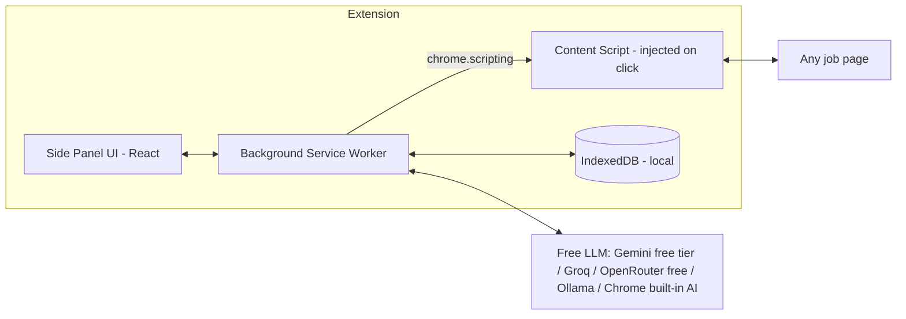

# Job Application Assistant: Chrome Extension Implementation Plan

## Decisions

| Topic | Decision |
|-------|----------|
| Cost | Free to run: free-tier cloud LLMs or on-device models; scoring runs locally with no API calls |
| Pages | Works on **any** page by default. LinkedIn, Greenhouse, and Lever adapters only improve accuracy on those sites |
| Output | Both DOCX and PDF, rendered from one shared resume JSON |

## Feasibility

All 5 features are possible with a Manifest V3 Chrome extension and an LLM. Risk depends on the feature:

| # | Feature | Feasibility | Main risk |
|---|---------|-------------|-----------|
| 1 | Resume upload and parsing | High | Parsing PDFs with multiple columns or tables |
| 2 | Job match score on any job page | High | Finding the job description on unknown pages; solved with the generic extractor and an LLM cleanup step |
| 3 | Tailored resume from the JD | High | The LLM making up experience; needs guardrails |
| 4 | Cover letter | High | Generic tone; fix with prompt and profile context |
| 5 | Form autofill | Medium | React-controlled inputs, iframes, shadow DOM, Workday multi-step forms |

## Architecture



- **Local-first:** the profile, jobs, and generated documents are stored in IndexedDB. No backend is needed for v1.
- **LLM calls run only in extension pages (side panel), never in content scripts.** API keys stay in `chrome.storage.local` and are never exposed to web pages. The side panel is used instead of the service worker because Chrome can stop a service worker during a long LLM call.
- **Minimal permissions:** `activeTab`, `scripting`, `storage`, `sidePanel`, plus optional `<all_urls>` site access. Chrome asks for site access on the first "Analyze" click, because buttons in the side panel don't grant `activeTab`. Scripts are injected only when the user clicks, never on page load.
- **Rendering happens in the side panel:** the service worker has no DOM, so DOCX and PDF files are built in the side panel.

## Free LLM Strategy

| Provider | Cost | Good for | Caveat |
|----------|------|----------|--------|
| **Google Gemini API, free tier** (Flash / Flash-Lite) | Free API key | **Default.** Strong writing, JSON mode, long context | Rate-limited. Google may use free-tier prompts to improve its products, so warn the user before sending resume data |
| **Groq, free tier** (Llama / Qwen models) | Free API key | Fast fallback, OpenAI-compatible API | Lower daily token limits |
| **OpenRouter `:free` models** | Free API key | Extra fallback | Daily request limits; models available vary |
| **Ollama (local)** | Free, runs on the user's machine | Most private; no limits | Needs a capable machine. Set `OLLAMA_ORIGINS=chrome-extension://*` |
| **Chrome built-in AI** (Gemini Nano Prompt API) | Free, on-device | JD cleanup and short extraction tasks | Small model, so not good enough for writing the resume or cover letter. Needs supported hardware |

- **One provider interface:** Groq, OpenRouter, and Ollama all expose an OpenAI-compatible API, so a single client plus a Gemini client covers all of them.
- **Fallback chain:** the user sets the order in Settings (default: Gemini, then Groq, then OpenRouter). On a `429` rate-limit response, the extension moves to the next provider.
- **Scoring is local and needs no AI calls:** it uses a skill dictionary with synonyms and categories, so it uses no API quota. Neural embeddings (`transformers.js`) are an optional later upgrade; they would add about 25 MB of WASM and model files.
- **Budget per job:** 1 call for analysis (JD cleanup and requirements combined), 1 for the resume, 1 for the cover letter, plus 1 batched call for any free-text form questions. Free tiers easily cover personal use.
- **Caching:** results are cached by URL hash and profile version, so a page is never re-sent unless something changed.
- Current free-tier limits change often; show them as a link in Settings rather than hard-coding them.

## Tech Stack

| Area | Choice |
|------|--------|
| Framework | [WXT](https://wxt.dev) (MV3, Vite, TypeScript, hot reload) |
| UI | React + Tailwind in `chrome.sidePanel` |
| Storage | IndexedDB via Dexie |
| Resume parsing | `pdfjs-dist` (PDF), `mammoth` (DOCX) |
| JD extraction | Generic pipeline (JSON-LD, Readability, LLM cleanup) with optional site adapters |
| LLM | Gemini client + OpenAI-compatible client (Groq, OpenRouter, Ollama) + Chrome Prompt API; Zod-validated JSON output |
| Matching | Skill dictionary (aliases + implied categories, e.g. PostgreSQL implies SQL), computed locally |
| Document export | `docx` (DOCX) + `@react-pdf/renderer` (PDF with selectable text, readable by applicant tracking systems), both rendered from one `ResumeDoc` JSON |
| Testing | Vitest (unit tests), Playwright with the extension loaded (E2E on saved HTML fixtures) |

## Data Model (IndexedDB)

```ts
Profile   { id, contact{name,email,phone,location,links}, summary, experience[{company,title,start,end,bullets[]}],
            education[], skills[], certifications[], workAuth, salaryExpectation, preferences, rawText, updatedAt }
Job       { id, url, source, title, company, location, description, requirements{mustHave[],niceToHave[],yearsExp,seniority}, capturedAt }
Analysis  computed on the fly from Profile + Job (not stored): { score, components[skills,keywords,experience,title,logistics], mustHave[], missingKeywords[], warnings[], summary }
Document  { id, jobId, type: 'resume'|'coverLetter', content(JSON/markdown), createdAt }
QAMemory  { question, answer }   // answers the user reuses for custom form questions
```

## Feature Design

### 1. Resume Upload and Parsing
1. The user uploads a PDF or DOCX in the side panel. Text is extracted locally.
2. The LLM converts the text into a structured `Profile` JSON (Zod schema, retried if the output is invalid).
3. An editable review form lets the user correct the parsed fields. **This step is important.** The profile becomes the source of truth.
4. Save the profile.

### 2. Job Match Score
1. The user clicks the toolbar icon or "Analyze job." The extractor is injected into all frames and tries these steps in order, stopping at the first that finds a JD:
   1. **Selected text:** if the user highlighted text, use it.
   2. **Site adapter (optional):** precise selectors when the hostname matches LinkedIn, Greenhouse, or Lever.
   3. **Structured data:** JSON-LD / microdata `JobPosting`, which many job boards and applicant tracking systems publish.
   4. **Readability:** extract the main article content.
   5. **Block heuristic:** score DOM blocks by text density and job keywords (e.g. "responsibilities," "requirements," "qualifications") and pick the best one across frames.
   6. **LLM cleanup:** send the best candidate (capped at about 12k characters). The LLM returns `{isJobPosting, title, company, location, description, requirements}`. If `isJobPosting` is false, ask the user to highlight the JD.
2. Requirement extraction happens in the same LLM call as cleanup: must-have and nice-to-have skills, years of experience, and seniority.
3. **The score is calculated in code, not by the LLM**, so it is stable and explainable:

| Component | Weight | Method |
|-----------|--------|--------|
| Must-have skills coverage | 40% | Normalized skill match (synonyms map, e.g. "k8s" = "Kubernetes") |
| Technology overlap | 25% | Share of technologies named anywhere in the JD that appear in the profile |
| Experience / seniority | 20% | Profile years vs. required years |
| Title / domain fit | 10% | Title similarity |
| Logistics | 5% | Location, remote status, work authorization |

4. Show the score (0–100), matched and missing skills, and a short explanation. The explanation is produced by template from the score breakdown, so it uses no extra LLM call. Cache results by URL and profile version.

### 3. Tailored Resume
- Input: the profile plus the JD requirements. Output: the same resume schema with reordered and rewritten bullets, an updated summary, and the JD's keywords where they are true.
- **Guardrails:** the prompt forbids adding companies, titles, dates, or skills that are not in the profile. A post-check diffs the output against the profile and flags any new entity.
- Show a side-by-side diff and let the user edit it.
- **Export:** one `ResumeDoc` JSON feeds two renderers using the same single-column template that applicant tracking systems can read:
  - DOCX via `docx`
  - PDF via `@react-pdf/renderer`, with selectable text and no images or tables
- File names follow `Name_Company_Role.pdf` / `.docx`. The user can also download both as a zip.

### 4. Cover Letter
- Input: the profile, JD, company name, and an optional tone or length setting.
- The user can edit and regenerate it, then export to DOCX and PDF (same renderers as the resume) or copy to the clipboard.

### 5. Form Autofill (generic, works on any form)
1. On "Autofill" click, inject the script into all frames (`allFrames: true`) to cover embedded application forms (e.g. Greenhouse and Lever iframes).
2. Detect fields: `input`, `select`, `textarea`, radio groups, and open shadow roots.
3. Map each field to a profile value in this order:
   - `autocomplete` attribute
   - `name`/`id`
   - `<label>`/`aria-label`/placeholder heuristics
   - Saved `QAMemory`
   - LLM fallback, batched into one call: unmapped fields plus free-text questions (e.g. "Why do you want to work here?")
4. Fill values in a way that works with React and Angular: use the native value setter, then dispatch `input` and `change` events.
5. Attach the resume by using a `DataTransfer` to set a `File` on `<input type=file>`.
6. Highlight filled fields (green) and fields that need review (yellow). **Never auto-submit.**
7. Learn from corrections: save the user's edited answers to `QAMemory`.
8. Multi-step forms (e.g. Workday): the user clicks "Autofill" again on each step. An optional adapter uses Workday's `data-automation-id` attributes for better accuracy.

## Project Structure

```
IJA/
  entrypoints/
    background.ts          # message router, LLM calls, DB access
    sidepanel/             # React app: Profile, Analyze, Resume, Cover Letter, Settings
    content/extract.ts     # JD extraction
    content/autofill.ts    # form detection + fill
  lib/
    llm/{provider.ts,gemini.ts,openaiCompat.ts,chromeAI.ts,fallback.ts,prompts.ts}  # openaiCompat = Groq/OpenRouter/Ollama
    parse/{pdf.ts,docx.ts,profileSchema.ts}
    extract/{pipeline.ts,selection.ts,jsonld.ts,readability.ts,heuristic.ts,adapters/*.ts}
    score/{text.ts,skills.ts,experience.ts,score.ts}
    autofill/{detect.ts,map.ts,fill.ts}
    export/{resumeDoc.ts,docx.ts,pdf.tsx}
    db.ts
  tests/{unit,e2e,fixtures/*.html}
  wxt.config.ts
```

## Phases

Status: Phases 0–6 are done (85 unit tests and 10 E2E tests passing). Phase 2 is tested on synthetic fixtures; real saved pages still need to be added.

Step-by-step plans for Phases 4–8 are in `docs/plans/`. See `CLAUDE.md` for how to work through them.

| Phase | Scope | Done when |
|-------|-------|-----------|
| 0. Setup | WXT scaffold, side panel, Settings (free provider keys + fallback order), Dexie DB, Gemini and OpenAI-compatible clients | Extension loads; test call works on Gemini free tier and falls back to Groq on `429` |
| 1. Profile | Upload, parse, structured extraction, editable profile form | PDF/DOCX resume becomes a saved, editable profile |
| 2. JD extraction | Generic pipeline (selection, JSON-LD, Readability, heuristic, LLM cleanup), then LinkedIn, Greenhouse, and Lever adapters | Correct JD extracted from 20+ saved fixtures from different sites, including ones without adapters |
| 3. Scoring | Skill normalization, weighted score, UI | Score + matched/missing list shown for the current page |
| 4. Tailored resume | Generation, fabrication check, diff view, DOCX + PDF export | Both files download and match the same template, with no invented facts |
| 5. Cover letter | Generation, editing, DOCX + PDF export | Both files download |
| 6. Autofill | Generic detect, map, and fill; file attach; iframes; QAMemory; highlighting | Fills test forms from 10+ different sites; no auto-submit |
| 7. Hardening | Workday adapter; rate-limit handling; error states; Playwright E2E | E2E suite passes |
| 8. Release | Privacy policy, Chrome Web Store listing, limited-use disclosure | Published (unlisted, then public) |

## Risks and Mitigations

| Risk | Mitigation |
|------|------------|
| LinkedIn or other site DOM changes | Generic pipeline is the main path; adapters are optional extras; manual highlight option |
| Site Terms of Service (LinkedIn bans automated scraping) | Read only the page the user is viewing, only on a user click; no crawling or bulk collection |
| PII privacy | Local storage only. Warning before the first cloud call that free tiers may use prompts for training. One-click switch to Ollama or Chrome built-in AI. "Delete all data" button |
| LLM making up experience | Schema-constrained output, fabrication diff check, mandatory user review |
| Autofill not working on custom widgets | Fallback: show copyable values for fields that couldn't be filled |
| Free-tier rate limits | At most 4 calls per job; caching; automatic fallback to the next provider on `429`; scoring makes no calls |
| Free-tier output quality varies | JSON validated with Zod and retried once; writing tasks routed to the strongest available model |
| Ollama CORS from the extension | Document setting `OLLAMA_ORIGINS=chrome-extension://*` |

## Open Decisions
1. Local-only for now; a backend for syncing across devices can be added later if needed.
